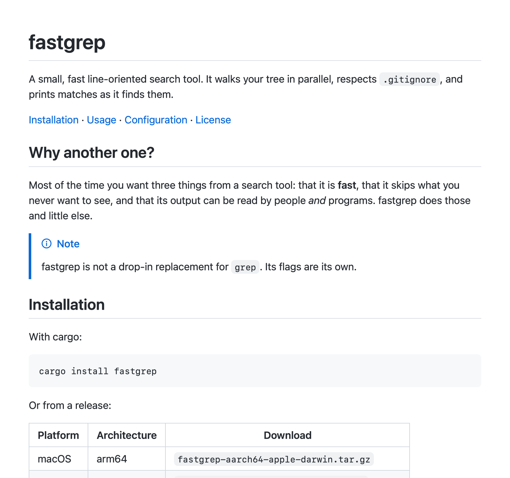

# die-markdown

Markdown in [DIE](https://github.com/0xDEADBEE7/die), drawn the way GitHub draws a README.
Press `\m` in a markdown file to read it as a page; press it again to edit.



## What it does

- Draws markdown as a page in the system font, at GitHub's sizes and spacing.
- Handles tables, task lists, alerts, footnotes, `<details>` and PNG pictures.
- Colours code blocks in more than 30 languages.
- Follows links: headings, other markdown files, and web pages in your browser.
- Keeps up with edits and keeps your place.
- Falls back to a tidy in-buffer view where there are no pixels to draw in.

## Install

Add it to your DIE config's `Cargo.toml`:

```toml
die-markdown = { git = "https://github.com/0xDEADBEE7/die-markdown", branch = "main" }
```

Then list it with your extensions and bind `\m`:

```rust
Box::new(die_markdown::Markdown::default()),
```

The full steps are in [docs/install.md](docs/install.md).

## Docs

- [Using it](docs/usage.md): what the page shows, links, options and faces.
- [Keys](docs/keys.md): scrolling, links and going back.
- [Installing it](docs/install.md): adding it to a config.
- [Developing it](docs/development.md): building beside DIE and running the tests.

## Licence

MIT or Apache-2.0, at your option: [LICENSE-MIT](LICENSE-MIT), [LICENSE-APACHE](LICENSE-APACHE).
